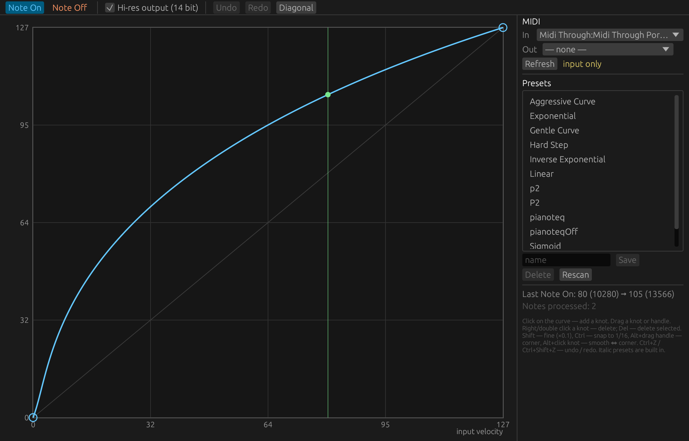

# MIDI Curves

[](https://doi.org/10.5281/zenodo.24408082)
[](https://github.com/ScherbakovAl/vst_midi_curves/actions/workflows/ci.yml)
[](https://github.com/ScherbakovAl/vst_midi_curves/releases/latest)
[](LICENSE)
[](#vst3-or-clap)
[](#download)
[](https://www.rust-lang.org/)

MIDI velocity curves as a **VST3/CLAP plugin** and a **standalone app** (Rust,
[nih-plug](https://github.com/robbert-vdh/nih-plug) + egui). Every Note On and
Note Off goes through its own editable Bézier curve, like *Curves* in an image
editor — and every key can have its own curve: set a few key notes, the curves
in between morph knot by knot. High-resolution (14-bit) velocity via the CC88
prefix is supported on input and output.



*Standalone app. The plugin shows the same editor without the MIDI panel.*

Video demo (older version): [YouTube](https://www.youtube.com/watch?v=CtjtueLHJKM)

## Features

- Two curves: **Note On** and **Note Off** (release velocity), each with its
  own undo/redo history.
- The curve passes through its knots; each knot has Bézier handles. The curve is
  always a function of velocity (handles are kept inside their segment).
- **Per-note curves.** Each of the 128 notes has its own curve table. Key notes
  (any number, A0–C8) hold curves with the same number of knots; between two
  key notes every knot moves along its own *morph lane* — a Bézier curve of the
  knot's x and y across the keyboard (straight by default, i.e. a linear morph;
  bend it to make a knee travel faster or slower). Knot handles are
  interpolated linearly. Below the first and above the last key note the curve
  of that key note holds. *Overrides* are single notes with a curve of their
  own, outside the morph. One key note (the default) = one curve for all notes.
- **Hi-res velocity (CC88, MIDI CA-031).** Incoming CC88 is always decoded:
  input x = (128·HH + LL)/16383 when a CC88 preceded the note on that channel,
  otherwise x = HH/127. The *Hi-res output* switch selects the output format:
  14 bit (CC88 + note, in the same sample) or plain 7 bit.
- A Note On never leaves with velocity 0 (that would be a Note Off).
- Everything else (CC, pitch bend, aftertouch, SysEx, clock) passes unchanged.
- Shared preset folder for the plugin and the app:
  `~/.config/vst_midi_curves/presets` (macOS: `~/Library/Application Support/…`,
  Windows: `%APPDATA%\…`). Two kinds of presets:
  - a **curve** — one shape: a click loads it into the selected note of the open
    tab; *Save curve* writes the curve of the selected note. Italic entries are
    built in;
  - **all** (shown as *name · all*) — the whole setup: Note On and Note Off
    curves of all notes (key notes, morph lanes, overrides) and the output
    format; *Save all* writes it, a click loads it in full.

  *Overwrite …* replaces a file with the typed name, *Delete* removes the file
  (click twice), *Rescan* re-reads the folder.
- Plugin state (all note curves, output format, open tab) is saved in the DAW project.
- Realtime path: no locks, no allocations, O(1) per note (≈ 20 ns per message,
  one table per note: ≈ 1 MB per instance); standalone loopback through ALSA
  adds ≈ 0 µs on top of midir (p99 69 µs total).

## Editor

The graph shows the curve of the selected note; the keyboard strip below it
selects the note and shows key notes (dots), overrides (squares) and the last
played note (green). Editing a note between key notes makes it a key note
first — exactly, no other note changes. A knot added or deleted on a key note
is added or deleted on all key notes (an added knot keeps every key curve as
it was). Faint curves are the neighbouring key notes.

| Action | Gesture |
|---|---|
| select a note | click it on the keyboard strip; *Follow playing* — the last played note |
| key note / override / remove | right click a key on the strip |
| move a key note | drag its key on the strip (between the neighbouring key notes) |
| add a knot (shape unchanged) | click on the curve |
| move a knot / handle | drag (Shift — fine ×0.1, Ctrl — snap to 1/16); a handle moves symmetrically — the opposite one is mirrored through the knot |
| move a handle independently | right-drag a handle (the opposite one keeps its length) |
| delete a knot | right click or double click; Del — selected knot |
| corner knot | Alt+drag a handle; Alt+click a knot toggles smooth ↔ corner |
| undo / redo | Ctrl+Z / Ctrl+Shift+Z (or the buttons) |
| reset | *Diagonal* — the selected note; *Reset notes* — one diagonal for all notes |

**Morph lane** (above the keyboard strip): select a knot on the graph — the lane
shows how that knot moves across the keyboard, *y* (output) or *x* (input; all
knots, red where lanes cross and the knot is clamped). Lane knots are the key
notes: drag one up/down to change the knot at that key note; the handles of the
selected key note bend the morph (drag — symmetric, right-drag — one side);
double click a lane knot — back to the linear morph.

The green marker shows where the last played note hit the curve (when it is
the selected note). In a DAW the
host may keep keyboard shortcuts for itself (in Reaper: enable *Send all
keyboard input to plugin* for the FX window); the buttons always work.

## VST3 or CLAP?

Prefer **CLAP** when you use hi-res velocity. In VST3, MIDI CCs reach the plugin
as parameter changes: within one sample nih-plug delivers all CCs before the
notes, so in a chord played in a single sample only the first note gets its own
LL, and a host may drop a CC88 that repeats the previous value. CLAP delivers
MIDI events in order and has neither problem.

## Download

Ready builds for Linux (x86_64), macOS (universal: Intel + Apple Silicon) and
Windows (x86_64): [Releases](https://github.com/ScherbakovAl/vst_midi_curves/releases/latest). Each archive holds
`MidiCurves.vst3`, `MidiCurves.clap` and the standalone `midi_curves`; where to
copy them — [BUILD_GUIDE.md](BUILD_GUIDE.md#install). `SHA256SUMS.txt` checks
the download: `sha256sum -c SHA256SUMS.txt --ignore-missing`.

- Linux: glibc 2.35 or newer (Ubuntu 22.04, Debian 12, Fedora 36 and later).
- macOS: the build is not signed; after unpacking run
  `xattr -dr com.apple.quarantine MidiCurves.vst3 MidiCurves.clap midi_curves`
  (or allow it in System Settings → Privacy & Security).

## Build

```bash
./build_linux.sh        # Linux: checks dependencies, then ./build.sh
./build.sh --install    # build, install to ~/.vst3 and ~/.clap, start Reaper (flatpak)
./build_macos.sh        # macOS universal binary (VST3 + CLAP bundles)
./build_windows.sh      # Windows (native or via `cross`)
```

Output: `build/midi_curves_v<version>/` with `MidiCurves.vst3`, `MidiCurves.clap`
and the standalone `midi_curves`. Details and dependencies: [BUILD_GUIDE.md](BUILD_GUIDE.md).

## Standalone

`midi_curves` connects one MIDI input to one MIDI output (e.g. keyboard →
*Midi Through* → a synth). Ports are matched by exact name, or by name without
the ALSA address (`… 24:0`) when the device reconnected under another client
number. The chosen pair is remembered and reconnected automatically: the port
lists are re-scanned every 2 s, a port that disappeared closes the connection and
the chosen device is connected as soon as it (re)appears — also when it is plugged
in after start. *Refresh* re-scans and reconnects at once. The app's own ports are
not listed (choosing them would make a loop). Settings live in `~/.config/vst_midi_curves/settings.json`
(old-format files are migrated; the old file is kept as `settings.v1.json` /
`settings.v2.json`).

## Compatibility

Projects, settings and presets saved by 0.1.0 open with the same curves (one key
note for all notes). The other way round does not work: 0.1.0 does not read the
per-note curves of a newer project (its curves fall back to the diagonal) or an
*all* preset — keep a copy of the project if you may need to go back.

## Tests

```bash
cargo test                                                         # all tests
cargo test --release --test realtime -- --include-ignored --nocapture  # + stress, ns/event
cargo build --features assert_process_allocs   # debug plugin that aborts on any allocation in process()
```

Tests never touch the real `~/.config` (temporary folders). See
[ARCHITECTURE.md](ARCHITECTURE.md) for the code map.

## Citation

If you use MIDI Curves in research, please cite it — see
[CITATION.cff](CITATION.cff) (GitHub: *Cite this repository*).

## License

The source code is MIT — see [LICENSE](LICENSE).

Built binaries (the release archives, and builds you make yourself) also contain
nih-plug's VST3 bindings ([vst3-sys](https://github.com/RustAudio/vst3-sys)),
which are GPLv3. So the binaries as a whole are distributed under the
[GNU GPL v3](licenses/LICENSE-GPL-3.0); their source is this repository at the
release tag.
